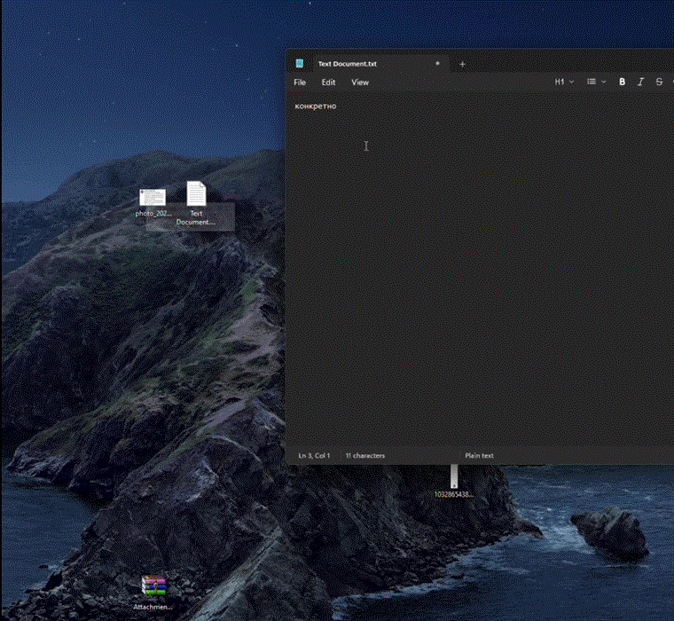

# QuickLook.Plugin.ImageViewerOcr

[](LICENSE)
[](https://github.com/konditerov/quicklook-ocr/stargazers)

Плагин для [QuickLook](https://github.com/QL-Win/QuickLook): картинка открывается сразу, печатный текст на ней можно выделить и скопировать. Распознавание идёт на этом компьютере.

Если плагин пригодился, поставьте [звезду](https://github.com/konditerov/quicklook-ocr/stargazers). Так его проще найти другим.

A [QuickLook](https://github.com/QL-Win/QuickLook) plugin: the picture opens immediately, and printed text on it can be selected and copied. Recognition stays on the machine.

If it saves you time, please [star the repository](https://github.com/konditerov/quicklook-ocr/stargazers).



| | |
| --- | --- |
| Автор / Author | [Ilia Konditerov](https://github.com/konditerov) |
| Дата / Date | 15 октября 2026 / 15 October 2026 |
| Версия / Version | 0.1.0 |
| Лицензия / License | [GPL-3.0](LICENSE) |

[Русский](#русский) · [English](#english)

Запрос в QuickLook: [#1608](https://github.com/QL-Win/QuickLook/issues/1608).

## Русский

### Установка

Нужны 64-битная Windows 10 или 11 и запущенный QuickLook.

1. Скачайте `QuickLook.Plugin.ImageViewerOcr.qlplugin` со [страницы релиза](https://github.com/konditerov/quicklook-ocr/releases/latest). В архиве около 26 МБ: сборка плагина, ONNX Runtime для win-x64 и две мобильные модели.
2. Выделите файл и нажмите пробел. В окне QuickLook нажмите **Install**.
3. Перезапустите QuickLook.
4. Откройте пробелом PNG, JPEG, BMP или TIFF. Картинка видна сразу. Текст появляется, когда распознавание заканчивается.

Каталог установки: `%AppData%\pooi.moe\QuickLook\QuickLook.Plugin\QuickLook.Plugin.ImageViewerOcr\`. У переносной сборки с файлом `portable.lock` это `UserData\QuickLook.Plugin\` рядом с программой.

### Как пользоваться

- Протяните мышь по тексту. Двойной щелчок выделяет слово.
- `Ctrl+C` копирует выделение. Если выделения нет, копируется весь распознанный текст.
- Правый щелчок: **Копировать** и **Копировать весь текст**.
- Колёсико меняет масштаб от курсора. Средняя кнопка сдвигает картинку. Пока масштаб не трогали, снимок вписан в окно.
- Пункт **Настройки распознавания текста** лежит в меню дополнительных действий окна предпросмотра.

GIF, APNG и SVG открывает встроенный просмотрщик. Этот плагин берёт себе `.png`, `.jpg`, `.jpeg`, `.bmp`, `.tif`, `.tiff`.

### Как это устроено

Окно рисует снимок и прозрачный слой слов в одном масштабе, поэтому подсветка едет вместе с картинкой при зуме и сдвиге. Распознавание идёт в фоне и отменяется, если окно закрыли. При старте QuickLook модели один раз прогреваются. Повтор того же файла берётся из кэша `%LocalAppData%\QuickLook.Plugin.ImageViewerOcr\cache` (путь, размер, дата изменения, движок).

В режиме **Авто** сначала PaddleOCR. Пункт **Windows AI** зарезервирован под [Windows AI Text Recognition](https://learn.microsoft.com/en-us/windows/ai/apis/text-recognition): вызов в этой версии не подключён, и плагин переходит дальше. **Windows OCR** (`Windows.Media.Ocr`) остаётся запасом, если установлен языковой пакет. Галочки «Русский» и «Английский» относятся только к нему.

Детектор смотрит кадр с длинной стороной до 960 пикселей. Координаты слов возвращаются в размер исходного файла. Для показа снимок длиннее 4096 пикселей декодируется до этой стороны.

### Какие модели и почему

Обе модели — мобильные ONNX-экспорты PP-OCRv5 от [RapidOCR](https://github.com/RapidAI/RapidOCR) / PaddleOCR. Серверные сети PP-OCRv5 весят десятки мегабайт каждая и для окна предпросмотра тяжелы. Мобильные помещаются в пакет около 26 МБ и уже читают печатный текст.

| Файл | Модель | Зачем |
| --- | --- | --- |
| `det.onnx`, 4,6 МБ | `ch_PP-OCRv5_det_mobile` | Находит области текста, в том числе слегка повёрнутые. Буквы не читает. |
| `rec_eslav.onnx`, 7,6 МБ, и `dict_eslav.txt` | `eslav_PP-OCRv5_rec_mobile` | Читает строку. Словарь: русский, украинский, белорусский, английский, цифры и знаки. |

Отдельной латинской модели нет: английские коды на русской накладной читает та же славянская сеть. Классификатора переворота в пакете нет: строка выпрямляется по четырёхугольнику детектора.

Считать есть на чём. Отдельного нейропроцессора на обычном настольном ПК нет: NPU встречается у части ноутбуков, а не у типичного десктопа. Поэтому скорости ниже — это скорость видеокарты. Граф ONNX открывается через DirectML и занимает видеопамять. На машине, где сняты цифры, это AMD Radeon RX 580 2048SP с 4 ГБ. Если DirectML на адаптере не стартует, та же модель считается на процессоре, и время будет другим.

### Скорость

Замер 15 октября 2026 на Windows, AMD Radeon RX 580 2048SP, 4 ГБ видеопамяти. Модели уже загружены. Прогрев при старте QuickLook занял 1,6 с.

| Кадр | Что на нём | Время |
| --- | --- | --- |
| 1600×900 | Скриншот, шесть строк интерфейса на русском и английском | 1,2 с |
| 900×220 | Две крупные строки HELLO / ПРИВЕТ | 0,3 с |
| 4200×900 | Те же две крупные строки на большом холсте | 0,3 с |
| около 1100×730 | Фото плотного печатного бланка, около 50 строк | 4,5–4,7 с |

Повтор того же файла после кэша сеть заново не гоняет.

### Что читается хорошо и что плохо

Хорошо, текст можно копировать почти как есть:

- крупный и средний печатный шрифт на скриншоте, скане и вывеске;
- строка на одном языке: русский или английский, если буквы контрастные;
- цифры, суммы, даты вида `2026-09-30`, длинные коды и индексы на печатном бланке;
- короткий знак вроде «КАФЕ» / «OPEN»;
- небольшой наклон строки: область выпрямляется.

На проверке целыми остались `Invoice 1042`, `Total 250.00`, `HELLO`, `ПРИВЕТ`, `КАФЕ`, `OPEN`. На фото бланка уцелели дата, код отправления, суммы и крупная подпись латиницей.

Плохо, в буфер попадёт мусор или сломанный регистр:

- заглавные буквы прыгают внутри слова: «Счёт оплачен 15 октября 2026» превращается в «Счёт Оплачен 15 октябрЯ 2026»;
- английское слово в русской строке путает похожие буквы: `Documents` стало `Dоситепts`;
- пробел между кодом и соседним словом иногда пропадает;
- мелкий шрифт внизу бланка, печати и подписи;
- китайский и любой алфавит вне словаря eslav: рамка может найтись, а строка читается как смесь кириллицы и латиницы;
- рукопись, сильное размытие, блик, декоративный шрифт;
- текст вверх ногами и вертикальные столбцы.

Строка с уверенностью ниже 0,35 на слой не попадает. Уверенная, но неверная строка на чужом алфавите всё равно может появиться.

### Стек

- C#, .NET Framework 4.7.2, WPF
- Плагин QuickLook: `IViewer`, `IMoreMenu`, субмодуль [QuickLook.Common](https://github.com/QL-Win/QuickLook.Common)
- Microsoft.ML.OnnxRuntime.DirectML 1.19.2
- System.Text.Json 8
- `Windows.Media.Ocr`

### Сборка

Нужны Windows, .NET SDK 8 или новее и целевой пакет .NET Framework 4.7.2.

```powershell
git clone --recurse-submodules https://github.com/konditerov/quicklook-ocr.git
cd quicklook-ocr
dotnet build QuickLook.Plugin.ImageViewerOcr.sln -c Release
powershell -File scripts/pack.ps1
```

Пакет: `dist\QuickLook.Plugin.ImageViewerOcr.qlplugin`.

```powershell
dotnet run --project QuickLook.Plugin.ImageViewerOcr.Tests -c Release --no-build
```

Сборка, `dist`, личные снимки и служебные заметки перечислены в `.gitignore`.

## English

### Install

You need 64-bit Windows 10 or 11 and QuickLook already running.

1. Download `QuickLook.Plugin.ImageViewerOcr.qlplugin` from the [release page](https://github.com/konditerov/quicklook-ocr/releases/latest). The archive is about 26 MB: the plugin, ONNX Runtime for win-x64, and two mobile models.
2. Select the file and press Space. Click **Install** in the QuickLook window.
3. Restart QuickLook.
4. Press Space on a PNG, JPEG, BMP, or TIFF. The picture shows at once. Text appears when recognition finishes.

Install folder: `%AppData%\pooi.moe\QuickLook\QuickLook.Plugin\QuickLook.Plugin.ImageViewerOcr\`. A portable build with `portable.lock` uses `UserData\QuickLook.Plugin\` next to the program.

### Use

- Drag across the text. Double-click selects a word.
- `Ctrl+C` copies the selection. With nothing selected, it copies all recognized text.
- Right-click: **Copy** and **Copy all text** (the menu is in Russian: **Копировать**, **Копировать весь текст**).
- The wheel zooms toward the cursor. The middle button pans. Until you zoom, the image fits the window.
- **Настройки распознавания текста** in the preview window’s extra menu opens the settings.

GIF, APNG, and SVG stay with the built-in viewer. This plugin takes `.png`, `.jpg`, `.jpeg`, `.bmp`, `.tif`, and `.tiff`.

### How it works

The window draws the photo and a transparent word layer in one transform, so highlights follow zoom and pan. Recognition runs in the background and is cancelled when the window closes. QuickLook warms the models once at startup. Opening the same file again reads `%LocalAppData%\QuickLook.Plugin.ImageViewerOcr\cache` (path, size, modification time, engine).

In **Auto** mode PaddleOCR goes first. **Windows AI** is reserved for [Windows AI Text Recognition](https://learn.microsoft.com/en-us/windows/ai/apis/text-recognition); that call is not wired up in this version, and the plugin moves on. **Windows OCR** (`Windows.Media.Ocr`) is the fallback when a language pack is installed. The Russian and English checkboxes apply only to that engine.

The detector sees a frame whose long side is at most 960 pixels. Word coordinates are mapped back to the original file. For display, an image longer than 4096 pixels on a side is decoded down to that size.

### Which models, and why

Both models are mobile ONNX exports of PP-OCRv5 from [RapidOCR](https://github.com/RapidAI/RapidOCR) / PaddleOCR. The server PP-OCRv5 networks are tens of megabytes each, which is a poor fit for a preview window. The mobile pair fits in a package of about 26 MB and already reads printed text.

| File | Model | Role |
| --- | --- | --- |
| `det.onnx`, 4.6 MB | `ch_PP-OCRv5_det_mobile` | Finds text regions, including a slight rotation. It does not read letters. |
| `rec_eslav.onnx`, 7.6 MB, plus `dict_eslav.txt` | `eslav_PP-OCRv5_rec_mobile` | Reads a line. The dictionary covers Russian, Ukrainian, Belarusian, English, digits, and punctuation. |

There is no separate Latin model: English codes on a Russian form are read by the same Slavic network. The package has no upside-down classifier. A line is straightened from the detector quadrilateral.

A typical desktop has no neural processing unit. An NPU shows up on some laptops, and a desktop graphics card is a different device. These timings are the graphics card, because that is what a desktop has. The ONNX graph is opened through DirectML and lives in video memory. The numbers below were measured on an AMD Radeon RX 580 2048SP with 4 GB. If DirectML cannot start on the adapter, the same model runs on the CPU and the times change.

### Speed

Measured on 15 October 2026, Windows, AMD Radeon RX 580 2048SP, 4 GB of video memory, models already loaded. Warmup when QuickLook starts took 1.6 s.

| Frame | Contents | Time |
| --- | --- | --- |
| 1600×900 | Screenshot, six interface lines in Russian and English | 1.2 s |
| 900×220 | Two large lines, HELLO / ПРИВЕТ | 0.3 s |
| 4200×900 | The same two large lines on a big canvas | 0.3 s |
| about 1100×730 | Photo of a dense printed form, about 50 lines | 4.5–4.7 s |

A cached file does not run the network again.

### What it reads well, and what it reads badly

Copied text is close to the source when the type is clean:

- large and medium printed type on a screenshot, scan, or sign;
- a line in one language, Russian or English, with solid contrast;
- digits, amounts, dates like `2026-09-30`, long codes, and postal codes on a printed form;
- a short sign such as «КАФЕ» / «OPEN»;
- a slight tilt: the region is straightened.

On the check, `Invoice 1042`, `Total 250.00`, `HELLO`, `ПРИВЕТ`, `КАФЕ`, and `OPEN` came through whole. On a photographed form, the date, shipment code, amounts, and a large Latin name survived.

The clipboard gets garbage or broken case when:

- capitals jump inside a word: «Счёт оплачен 15 октября 2026» becomes «Счёт Оплачен 15 октябрЯ 2026»;
- an English word inside a Russian line confuses lookalike letters: `Documents` became `Dоситепts`;
- the space between a code and the next word sometimes disappears;
- the type is the small print at the bottom of a form, a stamp, or a signature;
- the script is Chinese or anything outside the eslav dictionary: a box may be found, and the line comes back as mixed Cyrillic and Latin;
- the source is handwriting, strong blur, glare, or a decorative face;
- the text is upside down or set in vertical columns.

A line whose confidence is below 0.35 is left off the layer. A confident wrong line in an unsupported script can still show up.

### Stack

- C#, .NET Framework 4.7.2, WPF
- QuickLook plugin contracts: `IViewer`, `IMoreMenu`, submodule [QuickLook.Common](https://github.com/QL-Win/QuickLook.Common)
- Microsoft.ML.OnnxRuntime.DirectML 1.19.2
- System.Text.Json 8
- `Windows.Media.Ocr`

### Build

Windows, .NET SDK 8 or newer, and the .NET Framework 4.7.2 targeting pack.

```powershell
git clone --recurse-submodules https://github.com/konditerov/quicklook-ocr.git
cd quicklook-ocr
dotnet build QuickLook.Plugin.ImageViewerOcr.sln -c Release
powershell -File scripts/pack.ps1
```

Package: `dist\QuickLook.Plugin.ImageViewerOcr.qlplugin`.

```powershell
dotnet run --project QuickLook.Plugin.ImageViewerOcr.Tests -c Release --no-build
```

Build output, `dist`, private sample photos, and working notes are listed in `.gitignore`.

## Лицензия / License

Код плагина — [GNU GPL 3.0](LICENSE): он связывается с QuickLook. Модели PaddleOCR — Apache License 2.0, см. [`models/NOTICE.txt`](QuickLook.Plugin.ImageViewerOcr/models/NOTICE.txt).

The plugin code is [GNU GPL 3.0](LICENSE) because it links with QuickLook. The PaddleOCR models stay under the Apache License 2.0; see [`models/NOTICE.txt`](QuickLook.Plugin.ImageViewerOcr/models/NOTICE.txt).
